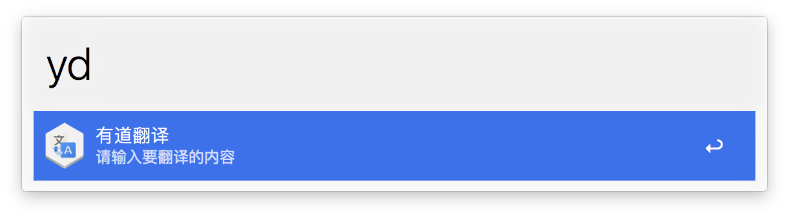

# YoudaoTranslate | 有道翻译

Alfred 中英文自动翻译工作流

## V4 更新说明

**解决 Apple Silicon (M1/M2/M3/M4) Mac 兼容问题。** V3 自带的 txiki 运行时仅支持 x86_64，在未安装 Rosetta 2 的 arm64 Mac 上无法运行（`bad CPU type in executable`）。

V4 使用多架构 txiki 运行时 + shell wrapper 自动检测 CPU 架构，**Intel 和 Apple Silicon Mac 均无需安装任何依赖即可使用**。

## 特性

- **无系统环境依赖** — 自带多架构 [txiki.js](https://github.com/saghul/txiki.js) 运行时，arm64 / x86_64 自适应
- **中英文自动互翻** — 支持 `CamelCase` 驼峰短语、多语言识别
- **多平台 API** — 支持有道翻译、百度翻译
- **快捷键翻译** — 双击 `⌥ Alt` 翻译选中内容
- **英文发音** — `⌘ Enter` 本地发音，`⌥ Enter` 在线语音
- **回车复制** — `↩︎ Enter` 复制翻译结果
- **网页预览** — `⇧ Shift` 预览有道网页

## 下载安装

- [GitHub Releases 下载](https://github.com/BernaLiuDev/YoudaoTranslator/releases)

## 配置

1. 注册[有道智云](https://ai.youdao.com/) 帐号，创建翻译服务和应用，获取 appKey 和 secret
2. 导入 Workflow 后，点击右上角 `[x]` 填入 Key 和 Secret

## 致谢

本项目基于 [wensonsmith/YoudaoTranslator](https://github.com/wensonsmith/YoudaoTranslator)（V3，3469 stars）。

### 原作者

## License

MIT
